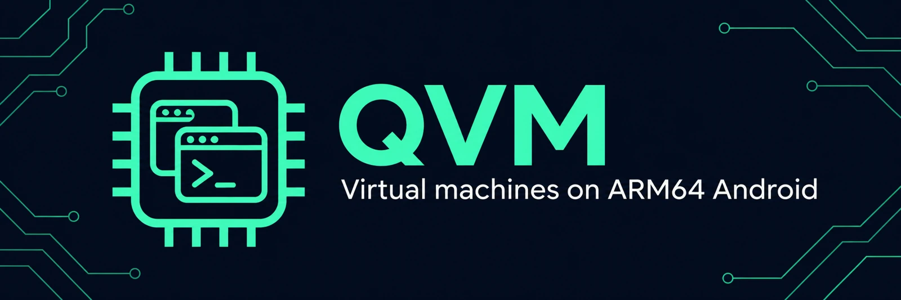

<p align="center"></p>

# QVM

QVM is a command-line virtual machine manager for people who need a QEMU VM on the go. It runs in Termux on ARM64 Android. Use it to install Debian from an ISO, boot a guest in the background, open its serial console, and manage templates and thin clones.

## Get Termux

[](https://play.google.com/store/apps/details?id=com.termux)

1. On your ARM64 Android phone, open [Termux on Google Play](https://play.google.com/store/apps/details?id=com.termux) and tap **Install**.
2. Open Termux and let it finish initializing.
3. Run the commands below in Termux. The installer installs QEMU and its dependencies, places the launcher at `~/qvm/qvm`, and adds the `qvm` command to your PATH.

```sh
pkg update
pkg install git
git clone https://github.com/tishriclarin/qvm.git ~/qvm-src
cd ~/qvm-src
bash install.sh
qvm help
```

You can also download the repository ZIP, extract it, and run `bash install.sh` from the extracted directory. Run `termux-setup-storage` and grant the Android permission if you need Termux to read Android Downloads. The installer leaves existing VM disks and configuration in place.

## Install and boot Debian

Download the **arm64** netinst ISO from the [official Debian installer page](https://www.debian.org/releases/trixie/debian-installer/) and verify it using [Debian’s verification instructions](https://www.debian.org/CD/verify). Save it to Android Downloads. In the example, give the downloaded ISO the filename `debian13.iso`.

```sh
termux-setup-storage
qvm install "$HOME/storage/downloads/debian13.iso" vnc
```

Open [AVNC on Google Play](https://play.google.com/store/apps/details?id=com.gaurav.avnc) and connect to the localhost address printed by QVM, usually `127.0.0.1:5900` for the first VM. Complete the Debian installer on the VM’s virtual disk. Once the installer finishes and QEMU exits, run these commands in Termux.

```sh
qvm list
qvm boot debian13 serial bg
qvm fg debian13
```

To use the serial console and SSH, enable them once **inside Debian** using an account with sudo access. You can use VNC to reach the guest if its serial login is unavailable.

```sh
sudo systemctl enable --now serial-getty@ttyAMA0.service
sudo apt update
sudo apt install openssh-server
sudo systemctl enable --now ssh
```

In a second Termux session, connect with the guest account you created. Use the port from `qvm list`. The first VM normally uses port 2222.

```sh
ssh -p 2222 your-debian-user@127.0.0.1
```

Press **Ctrl + ]** to detach from a serial console. The VM keeps running. A second QVM attachment reports the owning Termux session. Use `qvm stop debian13` for a clean shutdown. To import an existing VM from the earlier single-VM launcher, shut it down and run `qvm import debian13`.

## Add a home-screen widget

1. In Termux, run `qvm widget debian13`.
2. Long-press an empty spot on your Android home screen and open **Widgets**.
3. Search for **Termux** and add the list widget. Tap its refresh button if needed, then tap the Debian entry to open its console.
4. To use a pinned **Shortcut (1×1)**, select a stable shortcut from the picker. The list widget is the option for changing **RUNNING / STOPPED** labels.

To create a stable 1×1 shortcut for the same console, run this first:

```sh
mkdir -p "$HOME/.shortcuts"
cat > "$HOME/.shortcuts/Debian 13" <<'SHORTCUT'
#!/data/data/com.termux/files/usr/bin/bash
exec "$HOME/qvm/qvm" boot debian13 serial fg
SHORTCUT
chmod 700 "$HOME/.shortcuts/Debian 13"
```

The [Google Play build of Termux](https://github.com/termux-play-store) includes widget support. On the GitHub or F-Droid builds, install [Termux:Widget](https://github.com/termux/termux-widget) from the same source as Termux. Where the add-on supports dynamic shortcuts, run `qvm widget-menu debian13`, then use **Create Shortcuts** in Termux:Widget to publish **Stop** and **Restart** actions on the app icon’s menu.

## Configuration

QVM stores global settings in `~/qvm/qvm.conf`. Each VM has its own directory under `~/qvm/vm`, with `vms.conf`, a QCOW2 disk, and EFI variables. The default VM applies to commands such as `qvm boot`. Running bare `qvm` starts only the enabled VMs marked `autostart`.

```ini
[default]
vm=last-used

[vms]
debian13=enabled,manual
```

Set `vm=debian13` to select it explicitly, or set `debian13=enabled,autostart` to include it when you run bare `qvm`. SSH and VNC forwards bind to phone localhost. To make a thin clone, shut down the source VM, run `qvm template debian13`, then run `qvm clone debian13-template debian13-nms`. Keep the template disk available while its clones exist.

## CLI help

```text
qvm help                    Show commands and console keys
qvm                         Start enabled autostart VMs in the background
qvm boot [VM] [serial|vnc|x11] [bg|fg]
qvm fg [VM]                 Attach to a running VM's serial console
qvm stop VM                 Request a clean guest shutdown
qvm restart VM              Shut down cleanly and boot again
qvm install ISO [serial|vnc|x11]
qvm import NAME             Copy the original single-VM installation
qvm clone SOURCE [NAME]
qvm template VM
qvm remove VM [--yes]
qvm list
qvm widget [VM] [serial|vnc|x11] [bg|fg]
                             Serial widgets default to opening the console
qvm widget-menu VM           Create Stop and Restart launcher actions
qvm widget-refresh           Refresh VM status labels
qvm diagnose | repair
Serial console
  Enter                     Show the Debian prompt if the console is blank
  Ctrl + ]                  Detach and leave Debian running
  qvm fg [VM]               Reattach from the Termux prompt

Edit ~/qvm/qvm.conf for default VM, enablement and autostart.
```
